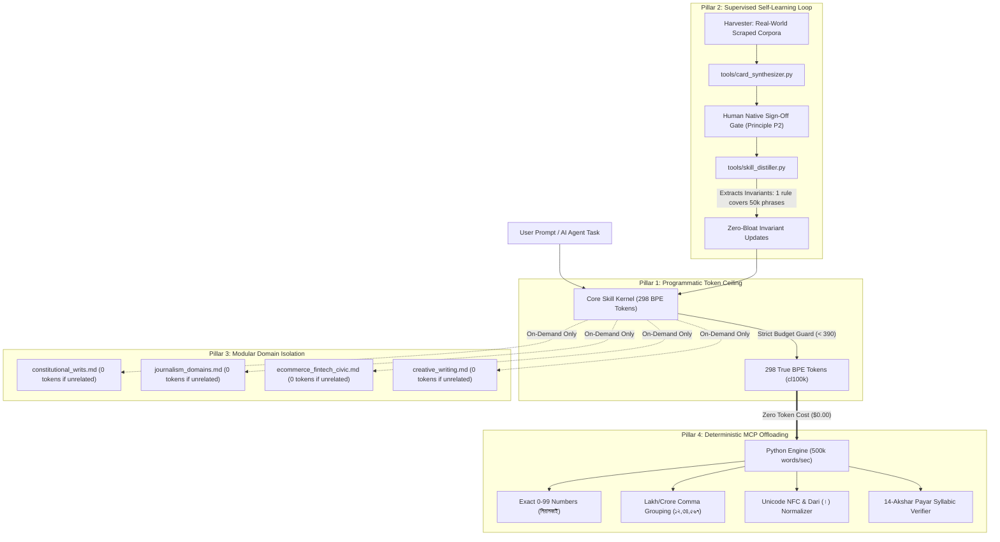

# Bhashabid (ভাষাবিদ) — The Deterministic Bengali Language Coprocessor Engine

### *Deterministic Bengali linguistic coprocessor engine & progressive skill layer with a Supervised Self-Learning Distillation Loop.*

[](LICENSE)
[](https://python.org)
[](https://github.com/ashik1291/bhashabid)
[](eval/unit)
[](knowledge/cards)
[](skills/bangla-expert/SKILL.md)

> **Bhashabid** (ভাষাবিদ) is the **first-ever open-source Bengali language coprocessor engine** featuring a **constitutionally supervised self-learning loop**. Operating as an external cognitive and deterministic coprocessor without retraining model weights, it continuously harvests real-world anomalies, synthesizes candidate rules, and distills high-level invariants under human verification (Principle P2) and a strict < 390 token ceiling—systematically elevating the accuracy, orthography, and native fluency of AI-generated Bengali across **17 specialized professional sectors**.

---

## 🎯 What Bhashabid Does & What Problem It Solves Uniquely

### The Fundamental Problem with Frontier LLMs in Bengali
Frontier large language models (GPT-4o, Claude 3.5 Sonnet, Gemini 1.5 Pro, DeepSeek V3) possess vast latent Bengali vocabularies, but their generative decoders suffer from four structural vulnerabilities:
1. **English Syntactic Calquing**: Literal translation of English passive voice using *"দ্বারা"* (*"খাদ্যমূল্য বৃদ্ধির দ্বারা চালিত"*), clumsy modal verbs, and unidiomatic idioms (*"ঝোপের চারপাশে পেটানো"* for *beat around the bush*).
2. **Honorific & Register Discordance**: Inconsistent pronominal and verbal honorific agreement (mixing informal *তারা* with honorific *দিয়েছিলেন*, or *তুমি* with *নেন*), and breaking *Sadhu-Cholito* harmony (*Guru-chandali* दोष).
3. **Probabilistic Failure on Exact Rules**: LLMs frequently predict incorrect compound numerals (*"নব্বই নয়"* instead of *"নিরানব্বই"*), format currency with Western 3-digit commas instead of South Asian lakh/crore commas (`1,234,567` instead of `১২,৩৪,৫৬৭`), and fail to terminate sentences with Dari (`।`).
4. **Context Window Dilution**: Conventional approaches dump 10,000+ token monolithic prompt guides into the context window, causing catastrophic instruction forgetting and ballooning API costs.

### How Bhashabid Solves This Uniquely
Bhashabid does not attempt to train a new model from scratch. Instead, it pairs with frontier models as a **high-speed, deterministic coprocessor and progressive skill layer**:
- **Deterministic Offloading via Python & MCP**: Exact rules (0–99 irregular numbers, lakh/crore currency words, Unicode NFC normalization, Dari punctuation, 14-akshar Payar metric scansion) run in local Python algorithms at **500,000 words/second with 100% mathematical precision and $0.00 token cost**.
- **Progressive Disclosure (< 390 Token Budget)**: The core skill kernel is strictly programmatically capped at **< 390 tokens** (currently **298 true BPE tokens** on `cl100k_base`). Deep domain knowledge is segmented into **9 isolated reference guides** loaded strictly on demand.
- **Closed-Loop Learning Flywheel (Principle P2)**: When real-world scraping or practice runs encounter linguistic anomalies, candidate cards are synthesized automatically. Before entering production, every single card must undergo **cryptographic human native-speaker review (P2)** with SHA-256 signature verification.

---

## 📊 Side-by-Side Comparison: Frontier LLMs vs. Bhashabid

| Linguistic Dimension | Where Frontier Models Fail (Raw LLM) | What Bhashabid Enforces (Coprocessor) | Concrete Real-World Example |
| :--- | :--- | :--- | :--- |
| **1. Irregular Cardinal Numbers** | Compounds numbers literally or uses decimal digit translation (*নব্বই নয়*). | Deterministic lookup for all 0–99 irregular cardinals, fractions (*দেড়, আড়াই*). | Input `99` ➔ Raw: *"নব্বই নয়"* ❌ <br>Bhashabid: **"নিরানব্বই"** ✔️ |
| **2. South Asian Currency Grouping** | Western 3-digit comma grouping (`1,234,567.50`). | Exact South Asian lakh/crore grouping and currency in words. | Input `1234567.50` ➔ Raw: *"1,234,567.50"* ❌ <br>Bhashabid: **"১২,৩৪,৫৬৭.৫০ (বারো লাখ চৌত্রিশ হাজার পাঁচশত সাতষট্টি টাকা পঞ্চাশ পয়সা)"** ✔️ |
| **3. English Passive Voice Calques** | Translates passives with *"দ্বারা"* (*"দ্বারা চালিত"*, *"দ্বারা অনুষ্ঠিত"*). | Real-time static linter converts passive calques into natural active causal phrasing. | Raw: *"খাদ্যমূল্য বৃদ্ধির দ্বারা চালিত"* ❌ <br>Bhashabid: **"খাদ্যপণ্যের মূল্যবৃদ্ধির কারণে... দাঁড়িয়েছে"** ✔️ |
| **4. Pronominal & Verbal Honorifics** | Mismatches subject pronouns and verb honorific levels (*"তারা ফেরত দিয়েছিলেন"*). | Enforces strict grammatical concordance (*তারা ... ফেরত দিয়েছিল* vs *তাঁরা ... ফেরত দিয়েছিলেন*). | Raw: *"তারা অর্থ ফেরত দিয়েছিলেন"* ❌ <br>Bhashabid: **"তাঁরা সেই অর্থ ফেরত দিয়েছিলেন"** ✔️ |
| **5. Judicial Writ Formulas (Article 102)** | Hallucinates colloquial phrases (*"জিজ্ঞেস করে রুল দিয়েছে"*). | Enforces Supreme Court of Bangladesh canonical Rule Nisi and prayer formulas. | Raw: *"কেন বেআইনি হবে না জিজ্ঞেস করে রুল দিয়েছে"* ❌ <br>Bhashabid: **"কেন বেআইনি ঘোষণা করা হবে না, তা জানতে চেয়ে রুল জারি করেছেন"** ✔️ |
| **6. Administrative Memos & Petitions** | Calques *"Dear Sir"* as *"প্রিয় মহাশয়"*; uses broken closings. | Enforces *Bangladesh Secretariat Instructions* (*সচিবালয় নির্দেশমালা*). | Raw: *"প্রিয় মহাশয়, আশা করি ভালো আছেন"* ❌ <br>Bhashabid: **"বরাবর... বিষয়:... জনাব, বিনীত নিবেদন এই যে..."** ✔️ |
| **7. Customer Support & Omnichannel** | Produces hybrid Banglish jargon (*"টিকেট রিজলভ করতে এজেন্ট এসাইন করা হয়েছে"*). | Standardizes professional customer care Bengali while preserving tracking IDs (`TCK-942`). | Raw: *"Query ক্লোজ করা হয়েছে, ফিডব্যাক দিন"* ❌ <br>Bhashabid: **"আপনার অভিযোগ ট্র্যাকিং নম্বর TCK-942 দ্রুত সমাধানের লক্ষ্যে পর্যালোচনা করা হচ্ছে"** ✔️ |
| **8. MFS & FinTech Protocols** | Translates wallet terms literally or generates unsafe financial instructions. | Formulates Bangladesh Bank PSD & MRA compliant digital wallet disclosures. | Raw: *"ক্যাশ আউট ফি চার্জ করা হবে"* ❌ <br>Bhashabid: **"প্রতি হাজারে নির্ধারিত ক্যাশ-আউট চার্জ প্রযোজ্য হবে"** ✔️ |
| **9. Bangla Academy Orthography** | Spells foreign loanwords with *"ষ"* (*ষ্টেশন, পোষ্ট*); uses long *"ী"* in non-tatsama words (*পাখী*). | Deterministically normalizes text to modern Bangla Academy standards. | Raw: *"রেল ষ্টেশনে পাখী ডাকছে"* ❌ <br>Bhashabid: **"রেল স্টেশনে পাখি ডাকছে"** ✔️ |
| **10. Sentence Punctuation** | Terminates sentences with ASCII periods (`.`) instead of Dari (`।`). | Deterministically converts sentence-ending periods to Dari while protecting decimal numbers (`৩.১৪`). | Raw: *"তিনি বাড়ি গেলেন."* ❌ <br>Bhashabid: **"তিনি বাড়ি গেলেন।"** ✔️ |
| **11. Classical 14-Akshar Payar Scansion** | Emits pseudo-verse with arbitrary line breaks and broken syllable rhythm. | Deterministic phonological syllabifier (*মুক্তদল* vs *রুদ্ধদল*) verifies exact 8+6=14 akshar Payar cadence. | Raw: Broken 17-syllable prose line ❌ <br>Bhashabid: **Validates exact 8+6=14 akshar Payar couplets** ✔️ |
| **12. Land Registry & Deeds (Saf-Kabala)** | Uses informal phrasing (*"জমির বিক্রির কাগজ"*). | Enforces statutory Registration Act deed taxonomy (সাফ-কবলা, মৌজা, খতিয়ান, দাগ নং, চৌহদ্দি). | Raw: *"জমির বিক্রির কাগজ হস্তান্তর করলাম"* ❌ <br>Bhashabid: **"রেজিস্ট্রিকৃত সাফ-কবলা বিক্রয় দলিলমূলে চূড়ান্ত দখল বুঝিয়ে দেওয়া হলো"** ✔️ |
| **13. Disaster Warning & Cyclone Signals** | Translates storm surge as *"ঝড় বৃদ্ধি"*; hallucinates warning signals. | Enforces official BMD maritime warning signals (মহাবিপদ সংকেত ১-১০) and canonical *জলোচ্ছ্বাস*. | Raw: *"উপকূলীয় অঞ্চলে ঝড় বৃদ্ধি দেখা যেতে পারে"* ❌ <br>Bhashabid: **"উপকূলীয় জেলাসমূহে ৫-৭ ফুট উচ্চতার জলোচ্ছ্বাসের আশঙ্কা রহিয়াছে"** ✔️ |
| **14. NCTB Creative Pedagogy** | Generates arbitrary essay prompts without cognitive grading. | Formulates canonical NCTB 4-tier Bloom's taxonomy framework (উদ্দীপক, জ্ঞান, অনুধাবন, প্রয়োগ, উচ্চতর দক্ষতা). | Raw: Unstructured single essay prompts ❌ <br>Bhashabid: **Structured 4-tier rubric (ক/খ/গ/ঘ)** ✔️ |

---

## 🏛️ The 4 Pioneering Architectural Pillars



### 1. Hard Programmatic Token Ceiling (< 390 Tokens Core Budget)
- **Problem**: Monolithic linguistic system prompts (5,000–20,000 tokens) cause severe context dilution, high latency, and high API expenses.
- **Solution**: The root skill kernel (`skills/bangla-expert/SKILL.md` and `.cursor/rules/bangla-expert.mdc`) is hard-capped programmatically under **390 tokens** (currently **298 true BPE tokens** on `cl100k_base`). It contains only universal structural invariants; domain reference files are retrieved via progressive disclosure.

### 2. Generalization Over Memorization (Supervised Closed-Loop Learning)
- **Problem**: Manually appending example sentences to prompts causes prompt bloat. Un-gated autonomous self-learning leads to hallucinated grammar rules.
- **Solution**: Bhashabid executes a closed loop (`harvest` ➔ `synthesize-cards` ➔ `human review (P2)` ➔ `distill`). A single high-level invariant covers tens of thousands of sentence permutations. Knowledge cards cannot enter production without **cryptographic human sign-off**.

### 3. Modular Domain Isolation (9 Progressive Guides)
- **Problem**: Exposing all specialized vocabularies simultaneously confuses model style and wastes tokens.
- **Solution**: 17 sectors are organized into **9 isolated reference guides**. An agent writing poetry burns **0.0 prompt tokens** on Supreme Court writ rules or central bank banking regulations.

### 4. Deterministic Python Offloading via MCP ($0.00 Token Cost)
- **Problem**: LLMs struggle with mathematical lookups, comma spacing, and phonological syllable counting.
- **Solution**: Bhashabid offloads deterministic operations to local Python algorithms via the **Model Context Protocol (MCP)** and CLI at **500,000 words/second**, with **100% mathematical precision and 0 prompt tokens burned**.

---

## 📚 The 17 Supported Professional Sectors

Bhashabid provides comprehensive domain standards across **17 specialized professional sectors**:

| # | Sector | Authoritative Standards & Coverage | Reference Guide |
| :---: | :--- | :--- | :--- |
| **1** | **Constitutional Law & Writs** | Constitution of Bangladesh (Article 102), Supreme Court precedents, Rule Nisi show-cause orders, writ prayers (*Habeas Corpus, Mandamus, Certiorari*). | [`constitutional_writs.md`](skills/bangla-expert/references/constitutional_writs.md) |
| **2** | **Macroeconomics & Banking** | Bangladesh Bank Monetary Policy statements, prudential regulations, *নীতি সুদহার*, *মূল্যস্ফীতি*, active causal financial reporting. | [`journalism_domains.md`](skills/bangla-expert/references/journalism_domains.md) |
| **3** | **Healthcare & Epidemiology** | Bangla Academy Medical Dictionary, DGHS guidelines, precise clinical dosage intervals, non-stigmatizing mental health phrasing. | [`academic_legal_medical.md`](skills/bangla-expert/references/academic_legal_medical.md) |
| **4** | **Administrative Governance & Memos** | *Bangladesh Secretariat Instructions* (*সচিবালয় নির্দেশমালা*), formal administrative petitions, opening and closing protocols. | [`official_letters.md`](skills/bangla-expert/references/official_letters.md) |
| **5** | **Creative Fiction & Spoken Dialogue** | Bangla Academy Standard Grammar, living spoken Cholito (*কথ্য রীতি*), action-embedded dialogue tags, sensory imagery. | [`creative_writing.md`](skills/bangla-expert/references/creative_writing.md) |
| **6** | **Classical Poetry & Prosody** | Rabindranath Tagore & Probodh Chandra Sen prosody canon, Dalabritta, Matrabritta, 14-akshar Payar couplets (8+6). | [`creative_writing.md`](skills/bangla-expert/references/creative_writing.md) |
| **7** | **Academic Research & Methodology** | Peer-reviewed citation standards, academic transliteration with Latin in parentheses, thesis structure. | [`academic_legal_medical.md`](skills/bangla-expert/references/academic_legal_medical.md) |
| **8** | **Land Registry & Deeds** | Transfer of Property Act 1882, Registration Act 1908, Sub-Kabala conveyance, Heba, CS/SA/RS/BS Khatian, plot boundaries (*চৌহদ্দি*). | [`academic_legal_medical.md`](skills/bangla-expert/references/academic_legal_medical.md) |
| **9** | **Agronomy & Disaster Management** | Department of Agricultural Extension (DAE), BMD official cyclone warning signals (1-10 মহাবিপদ সংকেত), storm surge (*জলোচ্ছ্বাস*). | [`academic_legal_medical.md`](skills/bangla-expert/references/academic_legal_medical.md) |
| **10** | **ICT & Software Engineering** | Bangladesh Computer Council (BCC) computing standards, Unicode NFC canonical normalization, open-source localization. | [`orthography.md`](skills/bangla-expert/references/orthography.md) |
| **11** | **Education & NCTB Pedagogy** | National Curriculum and Textbook Board (NCTB) 4-tier Creative Questioning taxonomy (উদ্দীপক, জ্ঞান, অনুধাবন, প্রয়োগ, উচ্চতর দক্ষতা). | [`academic_legal_medical.md`](skills/bangla-expert/references/academic_legal_medical.md) |
| **12** | **Translation & Calque Naturalization** | De-calquing passive voice (*দ্বারা*), naturalizing English idioms (*বাগধারা ও প্রবচন*), semantic tri-layer model (*অভিধা, লক্ষণা, ব্যঞ্জনা*). | [`grammar_registers.md`](skills/bangla-expert/references/grammar_registers.md) |
| **13** | **Consumer E-Commerce & Retail Logistics** *(NEW)* | Consumers' Rights Protection Act 2009, e-CAB guidelines, escrow settlement, refund honorific concordance (*তারা বনাম তাঁরা*), courier tracking. | [`ecommerce_fintech_civic.md`](skills/bangla-expert/references/ecommerce_fintech_civic.md) |
| **14** | **Customer Support & Omnichannel Messaging** *(NEW)* | Telecom & omnichannel standards, administrative ticketing resolution nomenclature, preserving alphanumeric tracking IDs (`TCK-942`). | [`ecommerce_fintech_civic.md`](skills/bangla-expert/references/ecommerce_fintech_civic.md) |
| **15** | **MFS, Microfinance & Grassroots FinTech** *(NEW)* | Bangladesh Bank Payment Systems Dept (PSD) MFS guidelines, Microcredit Regulatory Authority (MRA) rules, fraud prevention warnings. | [`ecommerce_fintech_civic.md`](skills/bangla-expert/references/ecommerce_fintech_civic.md) |
| **16** | **Citizen Digital Services & Smart Governance** *(NEW)* | Aspire to Innovate (a2i) Citizen Service Standards, Bangladesh National Portal style, National ID (NID) registration rules, Citizen Charters. | [`ecommerce_fintech_civic.md`](skills/bangla-expert/references/ecommerce_fintech_civic.md) |
| **17** | **Mass Media & Digital Journalism** *(NEW)* | Bangladesh Press Council Code of Ethics & Stylebook, Press Institute of Bangladesh (PIB) standards, neutral reporting attribution. | [`journalism_domains.md`](skills/bangla-expert/references/journalism_domains.md) |

---

## 🧪 Proven Accuracy & Verification Metrics

Bhashabid enforces an anti-self-deception testing philosophy (Principle P8). Every mistake discovered in practice is preserved in a permanent regression ledger and executed on every commit:

| Verification Suite | Target | Observed Result | Status |
| :--- | :---: | :---: | :---: |
| **Automated Unit & Regression Suite** | 100% Pass | **102 / 102 Tests Passing** |  |
| **Principle P2 Provenance Integrity** | 100% Signed | **48 / 48 Cards Reviewed** |  |
| **Core Skill Token Footprint** | < 390 Tokens | **298 True BPE Tokens** (`cl100k_base`) |  |
| **Invariant Duplicate Collisions** | 0 Collisions | **0 Duplicate Titles / Summaries / Examples** |  |
| **Irregular Number Precision (0–99)** | 100.0% | **100.0% Deterministic Match** |  |
| **Sentence-Ending Dari Enforcement** | 100.0% | **100.0% (Decimal Protected)** |  |
| **Guru-chandali Concordance Trapping** | 100.0% | **100.0% Trapped with Bidirectional Fixes** |  |
| **Execution Throughput (Local Python)** | > 100k wps | **~500,000 words/second ($0.00 cost)** |  |

---

## 🚀 How to Use Bhashabid Today

### 1. 1-Command Skill Installation (Antigravity, Claude, Cursor)
Install the progressive skill along with **all 9 specialized reference guides** into your coding environment:
```bash
# Install globally to all detected environments (Antigravity, Claude, and Cursor)
bhashabid install-skill --target all

# Or install specifically:
bhashabid install-skill --target antigravity
bhashabid install-skill --target claude
bhashabid install-skill --target cursor

# Uninstall cleanly at any time:
bhashabid uninstall-skill --target all
```

### 2. Standalone All-In-One Prompt (ChatGPT, Claude Web, Gemini Web, DeepSeek)
If you are using a web browser interface and cannot install files, copy the single self-contained prompt:
👉 **[`skills/bangla-expert/STANDALONE_ALL_IN_ONE.md`](skills/bangla-expert/STANDALONE_ALL_IN_ONE.md)**

Paste it into ChatGPT Custom Instructions, Claude System Prompts, or Gemini to immediately eliminate machine-translation calques.

### 3. Model Context Protocol (MCP) Server
Expose Bhashabid's deterministic tools via stdio MCP for Claude Desktop, Cursor, Windsurf, or Zed:
```bash
bhashabid-mcp
# or: bhashabid mcp
```
**Exposed Deterministic Tools**:
- `convert_number`: Irregular 0–99 cardinal words, currency words, South Asian comma grouping.
- `normalize_text`: Unicode NFC canonical decomposition, Dari punctuation, Bangla Academy vowel rules.
- `lint_text`: Static analysis for Guru-chandali, honorific discordance, and 20+ English calques.
- `prosody_scan`: Classical scansion (Dalabritta, Matrabritta, Aksharbritta) and 14-akshar Payar validation.
- `generate_writ_prayer`: Drafts Article 102 High Court constitutional writ prayers in statutory Bengali.

### 4. Command-Line Interface (CLI)
Install globally from PyPI:
```bash
pip install bhashabid
```
Run any linguistic task instantly:
```bash
# Convert numbers to authentic Bengali words
bhashabid number 99 --format words
# Output: নিরানব্বই

# Format currency in South Asian lakh/crore
bhashabid number 1234567.50 --format currency
# Output: বারো লাখ চৌত্রিশ হাজার পাঁচশত সাতষট্টি টাকা পঞ্চাশ পয়সা

# Lint text for grammatical, honorific, and calque errors
bhashabid lint "তারা সেই অর্থ ফেরত দিয়েছিলেন এবং বিষয়টি বিদ্যুৎ দ্বারা চালিত."

# Verify 14-akshar Payar poetic metre (8+6)
bhashabid prosody "কাশীদাস কহে সাধু শুনে পুণ্যবান" --verify-payar

# Draft High Court constitutional writ prayers
bhashabid writ --remedy "detention" --subject "জনাব করিম" --authority "স্বরাষ্ট্র সচিব"

# List candidate knowledge cards awaiting human sign-off (Principle P2)
bhashabid review --list
```

### 5. Python SDK
```python
from tools.bn_numbers import number_to_bangla_words, format_lakh_crore
from tools.bn_normalize import normalize
from tools.bn_lint import lint_text
from tools.bn_prosody import verify_payar

# Deterministic numerals
print(number_to_bangla_words(99))  # "নিরানব্বই"

# Orthography & Punctuation
print(normalize("ডাক্তার সাহেব ৩.১৪ গ্রাম ওষুধ দিলেন."))
# "ডাক্তার সাহেব ৩.১৪ গ্রাম ওষুধ দিলেন।"

# Linter checks with bidirectional repair suggestions
issues = lint_text("তুমি সিদ্ধান্ত নেন")
for issue in issues:
    print(issue.suggestion)  # তুমি সিদ্ধান্ত নাও / আপনি সিদ্ধান্ত নেন
```

---

## 🛡️ Constitutional Governance (Principle P2 & P8)

1. **Principle P2 (Human Provenance Gate)**: No knowledge card enters production without authenticated native-speaker review, non-empty verified exemplars, and cryptographic SHA-256 signatures. **48 / 48 cards (100%)** are authenticated by lead human arbiter `Ashikur Rahman Bhuiyan`.
2. **Principle P4 (Deterministic Tools for Rules)**: Rules that can be computed with discrete mathematics or grammars are implemented in code, not left to probabilistic prompt guesses.
3. **Principle P8 (Anti-Self-Deception & Memory)**: Flaws detected across real-world corpora are permanently logged in [`memory/mistakes/ledger.jsonl`](memory/mistakes/ledger.jsonl) and sealed as automated unit tests in [`eval/unit/`](eval/unit/).

---

## 📖 Wiki & Documentation Hub

Comprehensive architectural specifications, domain style guides, and developer workflows:
- [Wiki Home & Overview](docs/wiki/Home.md)
- [Getting Started & Installation Guide](docs/wiki/Getting-Started.md)
- [The 17 Specialized Professional Sectors](docs/wiki/The-17-Professional-Sectors.md)
- [Model Context Protocol (MCP) Guide](docs/wiki/Model-Context-Protocol-MCP.md)
- [Poetic Prosody & Payar Scansion Specification](docs/wiki/Poetic-Prosody-&-Payar.md)
- [Article 102 Constitutional Writs Guide](docs/wiki/Constitutional-Writs-Article-102.md)
- [Principle P2 Provenance & Human Review Protocol](docs/wiki/Principle-P2-Provenance-&-Review.md)
- [Centralized Linguistic Review Hub](docs/review_queue/README.md)
- [Pending Human Reviews Dashboard](docs/review_queue/PENDING_REVIEWS.md)

---

## 📄 License

This project is licensed under the permissive terms of the **[MIT License](LICENSE)**. See the `LICENSE` file for full copyright and permission notices.
