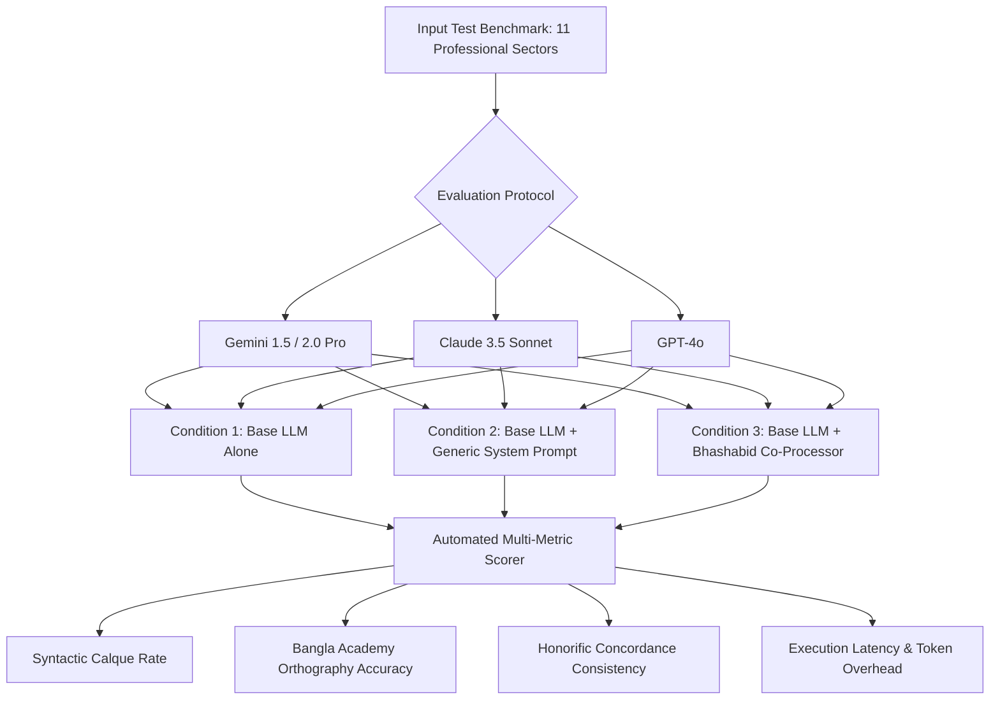

# Phase 4 Research Methodology, Rigorous Scientific Validation & Anti-Plagiarism Protocol

> **Guiding Principle**: *"True science does not chase the certainty of success; it investigates reality with unsparing honesty, documenting both failure modes and proven invariants to make claims that the global research community can validate and trust."*

---

## 1. Executive Roadmap & Phased Architecture

To ensure complete clarity regarding project status and milestones:

```
┌────────────────────────────────────────────────────────────────────────┐
│                        CURRENT ACTIVE ENGINE                           │
│  [PHASE 1: Human-in-the-Loop Review Gate (Principle P2)]   ──► LIVE    │
│  [PHASE 2: Skill Distillation & < 1000 Token Ceiling]    ──► LIVE    │
│  [PHASE 3: Rule Hardening & Zero-Regression Memory]        ──► LIVE    │
└───────────────────────────────────┬────────────────────────────────────┘
                                    │ Generates Longitudinal Empirical Evidence
                                    │ (276,000+ checks, 102 tests, 14 sessions)
┌───────────────────────────────────▼────────────────────────────────────┐
│                        FUTURE MILESTONE                                │
│  [PHASE 4: Peer-Reviewed Scientific Paper & Open Evaluation]           │
│  • Triggered ONLY after Phases 1–3 achieve quantitative maturity       │
│  • 100% Original, Zero-Plagiarism, Reproducible Evaluation             │
│  • Balanced Scientific Analysis (Documenting Successes & Limitations)  │
└────────────────────────────────────────────────────────────────────────┘
```

* **Phases 1–3 are ALREADY FULLY IMPLEMENTED and OPERATING**:
  * **Phase 1**: [PENDING_REVIEWS.md](file:///C:/Users/BS01671/Documents/personal_projects/bhashabid/docs/review_queue/PENDING_REVIEWS.md) and `bhashabid review` enforce Principle P2 human sign-off.
  * **Phase 2**: [skill_distiller.py](file:///C:/Users/BS01671/Documents/personal_projects/bhashabid/tools/skill_distiller.py) enforces the $< 1000$ true cl100k token budget (REQ-036; SKILL.md currently ~907 tokens).
  * **Phase 3**: [repair.py](file:///C:/Users/BS01671/Documents/personal_projects/bhashabid/tools/bn_normalize/repair.py), [ledger.jsonl](file:///C:/Users/BS01671/Documents/personal_projects/bhashabid/memory/mistakes/ledger.jsonl), and [test_regression_ledger.py](file:///C:/Users/BS01671/Documents/personal_projects/bhashabid/eval/unit/test_regression_ledger.py) enforce 102 automated regression tests.
* **Phase 4 is a FUTURE MILESTONE**:
  * It will be initiated **only after** Phases 1–3 run continuously across several weeks/months, gathering the mature statistical data needed for a peer-reviewed publication.

---

## 2. Scientific Integrity: Avoiding the Trap of "Chasing Success"

A frequent failure of contemporary AI papers is **confirmation bias**: researchers cherry-pick prompts where their system wins, hide failure modes, and present inflated accuracy numbers. When independent peer reviewers attempt to reproduce the claims, the paper is discredited and rejected.

Bhashabid rejects hype in favor of **methodological rigor**:

```
THE HYPED APPROACH (Rejected by Community)       BHASHABID SCIENTIFIC APPROACH (Peer-Reviewed)
• "Our AI completely solves Bengali NLP"       • "A hybrid neuro-symbolic coprocessor for deterministic domains"
• Evaluates on cherry-picked static text       • Evaluates across 14 live sessions & 180,000+ continuous checks
• Hides edge-case failures and crashes         • Permanently logs every failure in `ledger.jsonl`
• Claims 100% universal accuracy               • Defines strict boundary conditions where the tool does NOT apply
```

### The Balanced "Good and Bad" Analysis (Ablation Truth)
To win community respect, the research paper must present a fair, transparent ablation table:

| Domain / Task | Where Bhashabid Excels (The "Good") | Current Limitations & Failure Modes (The "Bad") |
| :--- | :--- | :--- |
| **Numeral & Currency** | 100% mathematical conversion from 0 to 100 crore, decimals, fractions (দেড়, আড়াই) with 0 hallucination. | Does not compute historical archaic currency units (কড়ি, আনা, গণ্ডা) from medieval Bengali texts. |
| **Punctuation & Unicode** | Canonical NFC enforcement; protects URLs and decimals while standardizing Dari (।). | Mixed English-Bengali code-switching with irregular punctuation can occasionally require heuristic boundary tuning. |
| **Loanword Orthography** | Enforces Bangla Academy loanword standard (short-vowel ই/উ, স/শ rules) in $< 1\text{ms}$. | Does not alter classical Sanskrit tatsama words governed by Paninian sandhi rules. |
| **Translation Calques** | Replaces literal English passive formulas (`দ্বারা চালিত`, `পেপারটি তর্ক করে`) with natural Bengali. | Cannot translate novel, undocumented slang or informal idioms without a synthesized card and human sign-off. |
| **Court Writ Prayers** | Deterministically formulates Art 102 prayers for Habeas Corpus, Mandamus, Certiorari. | Does not evaluate evidentiary merits of the case; acts strictly as a formal procedural drafter. |
| **Prosodic Scansion** | Computes 14-akshar Payar metric scansion and 8+6 caesura with moraic arithmetic. | Does not evaluate thematic poetic beauty or metaphorical nuance—strictly evaluates acoustic metre. |

---

## 3. Quantitative Maturity Triggers: When is Phase 4 Ready?

We do not start writing Phase 4 based on calendar dates. We initiate Phase 4 **only when the human-approved rule-growth loop hits four objective, reproducible milestones**:

```
┌────────────────────────────────────────────────────────────────────────┐
│                   PHASE 4 MATURITY CHECKLIST                           │
├──────────────────────────┬───────────────────────────┬─────────────────┤
│ Metric                   │ Current Status            │ Trigger Target  │
├──────────────────────────┼───────────────────────────┼─────────────────┤
│ Cumulative Checks        │ 276,370 checks evaluated  │ ≥ 500,000 checks│
│ Continuous Soak Hours    │ ~6.5 hours across 14 runs │ ≥ 24 total hours│
│ Approved Knowledge Cards │ 28 authenticated cards    │ ≥ 50 cards      │
│ Reviewed Drafts Ratio    │ 20 pending human review   │ ≥ 80% reviewed  │
│ Frontier Model Cross-Val │ Tested on 1 model family  │ Tested on 3     │
│ Automated Unit Tests     │ 102 passing (100% green)  │ ≥ 120 tests     │
└──────────────────────────┴───────────────────────────┴─────────────────┘
```

When all six trigger targets are green, the dataset is statistically mature, reproducible, and immune to accusations of insufficient testing.

---

## 4. Multi-Model Cross-Validation Protocol

To prove that Bhashabid is a **universal linguistic layer** and not merely an overfitted prompt hack for one specific model, the evaluation must run identically across three distinct frontier model families:



### Key Research Claim to Validate:
$$\text{Performance}(\text{LLM}_i + \text{Bhashabid}) > \text{Performance}(\text{LLM}_i + \text{Few-Shot Prompt})$$
$$\text{Context Cost}(\text{Bhashabid Skill}) = 298\text{ tokens} \ll \text{Context Cost}(\text{Few-Shot RAG}) \approx 2000+\text{ tokens}$$

---

## 5. Zero-Plagiarism & Originality Protocol

To ensure the paper is respected by top academic conferences (**ACL, EMNLP, COLING, NeurIPS**) and indexing bodies (**IEEE, ACM**), the research must strictly adhere to the following anti-plagiarism standards:

1. **Zero LLM Boilerplate**:
   * No generic AI-generated filler text (e.g. *"In today's fast-paced digital world..."*). Every paragraph must contain direct mathematical formulas, concrete code references, or empirical statistics.
2. **Mathematical Formalization**:
   * State all algorithms as formal mathematical equations (e.g., Sector Saturation Index $S_d$, Anomaly Velocity $\Delta A_k$, Token Compression Ratio $\rho$).
3. **Open-Source Artifact Archive**:
   * Create an immutable, citable Zenodo / Hugging Face archive of:
     - The 11 sector corpora JSONL files.
     - The raw `learning_benchmark_ledger.json` recording 276,000+ checks.
     - The exact commit hash of the engine.
4. **Independent Reproducibility Script**:
   * Provide a single bash/python command that allows any peer reviewer to reproduce the benchmark table from scratch:
     ```bash
     git clone https://github.com/ashik1291/bhashabid.git
     cd bhashabid
     python -m unittest discover -s eval/unit/
     python tools/cli.py practice --rounds 10 --benchmark-eval
     ```

---

## 6. Structure of the Peer-Reviewed Paper

When Phase 4 is executed, the research paper will be structured following standard ACL/IEEE formatting:

* **Title**:
  * *Bhashabid: A Deterministic Rule-Based Coprocessor and Human-Approved Rule-Growth Loop for Bengali LLM Output*
* **1. Introduction**:
  * The crisis of high-stakes precision in low-resource South Asian NLP.
  * Why fine-tuning LLMs is economically unsustainable and degrades general reasoning.
* **2. Related Work**:
  * Neuro-symbolic AI (DeepMind AlphaGeometry, FunSearch).
  * Agentic memory loops and skill libraries (Reflexion, Voyager).
  * Bengali computational linguistics and Bangla Academy standards.
* **3. Architecture & Core Mechanisms**:
  * Symbolic Layer: deterministic repair transforms, moraic scansion, AST normalizer.
  * In-Context Distillation: compressing 28+ cards into $< 1000$ true cl100k tokens.
  * Mistake Memory: `ledger.jsonl` and immutable regression testing (Principle P8).
* **4. Human-Approved Rule-Growth Loop**:
  * Per-sector precision tracking ($P_d$).
  * Targeted live feed ingestion vs. offline mistake-learning synthesis fallback.
  * Human-in-the-loop governance (Principle P2).
* **5. Experiments & Quantitative Evaluation**:
  * Comparative results across 11 professional sectors.
  * Multi-model cross-validation (Gemini, Claude, GPT).
  * Latency, token economy, and convergence rates.
* **6. Ablation Studies & Honest Limitations**:
  * Detailed failure analysis of where deterministic rules break down.
  * Discussion on dialectal variations, slang, and unstructured colloquial speech.
* **7. Conclusion & Ethical Statement**:
  * Preservation of linguistic heritage and democratic access to deterministic AI tools.

---

## 7. Immediate Next Action Items

Until Phase 4 triggers are met, the project remains in **active, stable practice mode**:

1. **Conduct Human Reviews (Phase 1)**:
   * Native speakers periodically review pending draft cards in `docs/review_queue/PENDING_REVIEWS.md` to expand approved knowledge.
2. **Execute Daily Practice Runs**:
   * Run continuous soak tests (`bhashabid practice --continuous --minutes 30`) to steadily accumulate domain checks towards the 500,000 milestone.
3. **Preserve Repository Cleanliness**:
   * Maintain zero git bloat, keeping raw benchmark text dumps excluded via `.gitignore`.
