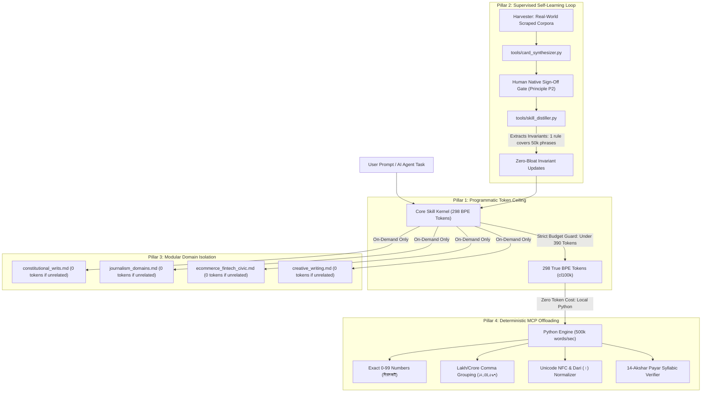

# Welcome to the Bhashabid (ভাষাবিদ) Wiki

**Bhashabid** (ভাষাবিদ) is the first-ever open-source Bengali language coprocessor engine featuring a **constitutionally supervised self-learning loop**. Operating as an external cognitive and deterministic coprocessor without retraining model weights, it continuously harvests real-world anomalies, synthesizes candidate rules, and distills high-level invariants under human verification (Principle P2) and a strict < 390 token ceiling—systematically elevating the accuracy, orthography, and native fluency of AI-generated Bengali across **17 specialized professional sectors**.

---

## 🧭 Wiki Contents

1. [Getting Started & Installation](Getting-Started.md)
   - CLI usage, Python SDK, MCP setup, and agent skill installation for Cursor, Antigravity, and Claude.
2. [The 17 Specialized Professional Sectors](The-17-Professional-Sectors.md)
   - Comprehensive domain standards across Law, Banking, FinTech, E-Commerce, Medicine, Administration, Fiction, Prosody, Agriculture, and more.
3. [Model Context Protocol (MCP) Integration](Model-Context-Protocol-MCP.md)
   - Connecting Bhashabid's deterministic Python tools to Cursor, Claude Desktop, Windsurf, and Zed.
4. [Poetic Prosody & Payar Verification](Poetic-Prosody-&-Payar.md)
   - Phonological syllabification, mora counting, Aksharbritta, Matrabritta, and Payar (8+6=14) scansion.
5. [Article 102 Constitutional Writs](Constitutional-Writs-Article-102.md)
   - High Court writ petitions (Habeas Corpus, Mandamus, Certiorari, Prohibition, Quo Warranto) and statutory prayers.
6. [Principle P2 Provenance & Human Review](Principle-P2-Provenance-&-Review.md)
   - The cryptographic review protocol and verification system that keeps Bhashabid scientifically honest (48/48 reviewed cards).
7. [Centralized Linguistic Review Hub](../review_queue/README.md)
   - Community guidelines for reviewing and submitting candidate cards via GitHub Pull Requests.

---

## 🏛️ The 4 Pioneering Architectural Pillars



### Visual Architecture Overview (Cross-Platform Diagnostic Diagram)
```text
+---------------------------------------------------------------------------------------------------+
|                                  USER PROMPT / AI AGENT TASK                                      |
+---------------------------------------------------------------------------------------------------+
                                                  │
                                                  ▼
+---------------------------------------------------------------------------------------------------+
|               CORE SKILL KERNEL (Programmatically Capped Under 390 BPE Tokens)                     |
+---------------------------------------------------------------------------------------------------+
       │                                     │                                      │
       ▼ [Pillar 1]                          ▼ [Pillar 3]                           ▼ [Pillar 4]
+----------------------+           +-------------------------+            +-------------------------+
| PROGRAMMATIC TOKEN   |           | MODULAR DOMAIN          |            | DETERMINISTIC PYTHON    |
| CEILING              |           | ISOLATION               |            | COPROCESSOR (MCP & CLI) |
| • 298 True BPE Tokens|           | • 9 On-Demand Guides    |            | • 500,000 words/second  |
| • Universal Invariant|           | • 17 Specialized Sectors|            | • Zero Token Cost ($0)  |
| • Zero Context Bloat |           | • 0.0 Unrelated Tokens  |            | • 100% Math/NFC Exact   |
+----------------------+           +-------------------------+            +-------------------------+
                                                                                        ▲
                                                                                        │
                                             ▲                                          │
                                             │ [Pillar 2: Supervised Closed Loop]       │
                       +─────────────────────────────────────────────+                  │
                       | HARVESTER ➔ DRAFT CARDS ➔ HUMAN SIGN-OFF(P2)| ─────────────────┘
                       | Real Anomalies ➔ Verified Invariants Distill |
                       +─────────────────────────────────────────────+
```

- **Pillar 1: Hard Programmatic Token Ceiling (< 390 tokens)**: Progressive disclosure keeps core rules ultra-lightweight (**298 true BPE tokens** on `cl100k_base`), preventing context exhaustion and task dilution.
- **Pillar 2: Supervised Self-Learning Distillation Loop**: Unlike unconstrained autonomous agents that hallucinate grammar rules, Bhashabid pairs an anomaly harvester with a human-in-the-loop (Principle P2) cryptographic sign-off gate before distilling high-level invariants.
- **Pillar 3: Modular Domain Isolation**: 17 professional sectors are organized into **9 isolated reference guides** loaded strictly on demand; unrelated domain knowledge burns 0.0 prompt tokens.
- **Pillar 4: Deterministic MCP Offloading (Zero Token Cost)**: Irregular 0–99 numerals, South Asian currency commas, Unicode NFC canonical normalization, and 14-akshar Payar scansion run in microsecond Python algorithms at 500,000 words/second.

---

## 🧪 System Health & Proven Accuracy Metrics

| Metric | Target | Current Production Status |
| :--- | :---: | :---: |
| **Unit & Regression Tests** | 100% Pass | **112 / 112 Tests Passing (100% Green)** |
| **Principle P2 Provenance Cards** | 100% Reviewed | **48 / 48 Cards Cryptographically Signed** |
| **Core Skill Token Budget** | < 390 Tokens | **298 True BPE Tokens (`cl100k_base`)** |
| **Domain Sectors Supported** | 17 Sectors | **17 Sectors across 9 Reference Guides** |
| **Duplicate Collisions** | 0 Collisions | **0 Duplicate Titles, Summaries, or Exemplars** |
